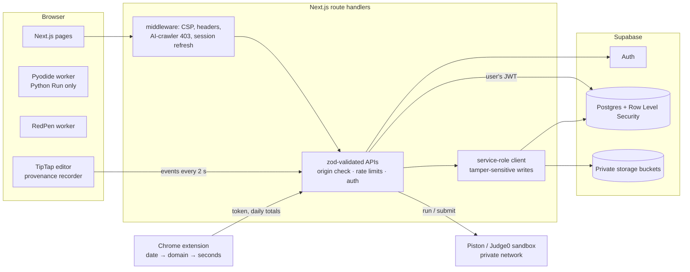

<p align="center"></p>

# Humagination

**Learn and create with your own mind — checked by code, never by AI.**

Humagination is a hackathon project on an *anti-AI* theme. It helps people stop leaning on AI chatbots, and it uses **zero AI itself**. Every feature is plain, deterministic code: parsers, equation solvers, regular expressions, hash chains, digital signatures and image maths. A script enforces this on every lint run.

The app has four parts:

| Part | What it does for the user |
|---|---|
| **Tutor** — StepCheck, Code Dojo, RedPen | Checks your work line by line and tells you *where* and *what kind* of mistake you made. It never gives the answer. |
| **Written Here** — authentic editor | Records how a text was written, keystroke by keystroke, and issues a signed certificate plus a public replay that proves it was typed here. |
| **Reliance Tracker** — Chrome extension + dashboard | Measures your active time on AI sites and compares it with time you spent thinking for yourself. |
| **Protected Gallery** — art, writing, music | Shares human-made work while refusing AI crawlers. Originals are encrypted, and every view is watermarked with the viewer's name. |

---

## Contents
1. [Features in detail](#features-in-detail)
2. [How it's built](#how-its-built)
3. [Getting started](#getting-started)
4. [Security model](#security-model)
5. [How everything is verified](#how-everything-is-verified)
6. [Known limitations](#known-limitations)
7. [Demo script (3 minutes)](#demo-script-3-minutes)
8. [Contributing](#contributing)

---

## Features in detail

### 1. StepCheck — math tutor (`/tutor/math`)
Students solve a problem one step per line. Each line renders live as math (KaTeX).

- **The first wrong line turns red.** Lines after it grey out until it's fixed.
  - *Expressions* are equivalent if `simplify(a − b) = 0` (mathjs), or, as a fallback, if they agree numerically at 8 seeded random points.
  - *Equations* are equivalent if they have the same real solution set (nerdamer, with every root checked by plugging it back in).
- **Finishing requires the right final form:** `x` isolated, fully expanded, factored, a fraction in lowest terms, and so on.
- **Tiered hints, all hand-written rules:**
  1. Tier 1 names the line.
  2. Tier 2 names the mistake: sign error, operation on only one side, partial distribution, dividing only one term, or arithmetic slip.
  3. Tier 3 points at the exact term.

  Each tier unlocks only after another failed attempt. Each rule rebuilds what the line *would* be if the student had made that mistake, and checks whether that matches.
- 20 problems: linear and two-step equations, factoring quadratics, expanding, simplifying fractions, and derivatives of polynomials (`packages/shared/problems/math/`).
- Checking runs **on the server**, so the answer never reaches the browser.

### 2. Code Dojo — Python, C, Java (`/tutor/code`)
- **36 exercises:** 12 per language, on the *same concept ladder* with the *same tests*, so students can compare languages. The ladder: I/O → conditionals → loops → functions → arrays → strings → structs/classes → recursion → pointers (C) / interfaces (Java) → three mini projects (grade calculator, text statistics, bank account).
- **Run:** Python runs instantly in the browser with Pyodide (5 s timeout, no network). C and Java run on the server against the example tests.
- **Submit:** always graded **on the server** against hidden tests too, so completions and points can't be faked. Hidden tests report only a pass count. Visible tests show a line diff.
- **Error Explainer:** 30 hand-written rules per language turn compiler and runtime errors into plain English, with a "where to look" pointer, and highlight the reported line. C also has **Check memory** (AddressSanitizer + UBSan, Judge0 only).
- Required and forbidden code patterns, for example "no loops" in the recursion exercise, or "don't use `gets()`".
- Hints unlock after 2, 4 and 6 failed submissions. **There is no "show solution" button.**
- **Rosetta view:** after solving an exercise, compare *your own* solutions to it across languages.

### 3. RedPen — writing coach (inside the editor)
Flags passive voice, filler and weasel words, hedges and intensifiers, sentences over 30 words, repeated words, clichés, complex words, possibly insensitive wording and wordy phrases. It also shows Flesch reading-ease and grade-level scores. Each flag explains *why* it matters and gives a generic example. **RedPen never rewrites text and offers no one-click fixes.**

### 4. Written Here — authentic editor + certificates (`/write`, `/verify`)
1. Every edit (insert, delete, paste, cut, undo, redo, focus, blur) becomes an event in a **SHA-256 hash chain**. Events go to the server every 2 seconds.
2. For each batch, the server recomputes the chain, **replays the edits onto its own copy of the text**, checks it matches the editor exactly, and records the **server receipt time**. That makes a log fabricated offline easy to spot.
3. Pastes from outside the document that are longer than 40 characters are allowed, but they're highlighted and count against authenticity.
4. **Finalize** replays the whole log from an empty page and computes:
   - the % of the final text typed here
   - external pastes
   - typing speed, flagging more than 120 wpm sustained over a minute
   - "injection bursts": text that appears instantly without a paste
   - the revision ratio (near-zero revisions suggests transcription)
   - whether the client timeline is consistent with the server's clock

   The verdict is **Human-Verified**, **Mostly Human** or **Unverified**.
5. The server signs a certificate with **Ed25519**. Its public page shows the verdict and statistics, re-checks the signature, chain and replay on every load, and includes a **replay player** (1×, 5×, 20×) that re-types the document. Pastes flash amber.
6. `/verify` lets anyone check pasted certificate JSON plus text **entirely in their browser**.

### 5. Reliance Tracker — Chrome extension (`apps/extension`) + dashboard (`/dashboard`)
- Counts **active** time only: an AI site's tab is focused, its window is focused, and the user isn't idle. The extension tracks 13 sites (ChatGPT, Claude, Gemini, Copilot, Perplexity…) plus any custom domains you add.
- **Privacy:** it stores and sends only `{date, domain, seconds}`. It never sees URLs, page content, prompts or keystrokes. The popup shows the exact JSON it will send.
- **Think First mode** (optional): before an AI site opens, it shows a "write your own attempt first" page with a 2-minute timer and links to non-AI tools. You can always continue.
- **The dashboard** shows a weekly chart of AI vs human minutes, the **Reliance Score** (`100 × AI ÷ (AI + human + 1)`, lower is better), a streak, **Human Points** (capped daily) and a per-site breakdown.
- **Weekly leaderboard:** opt-in only, with friends by username invite, and labelled *"Self-reported via extension — for motivation, not proof."*

### 6. Protected Gallery (`/gallery`)
- **Art upload pipeline:**
  1. The file type is checked by its bytes, not its name.
  2. The image is re-encoded, which strips EXIF and GPS data and anything hidden in the file.
  3. A SHA-256 and a hand-written **perceptual hash (dHash)** block re-uploads of someone else's work.
  4. An **invisible, HMAC-signed ownership watermark** is hidden in the image's pixels.
  5. The original is **encrypted** and never served.
- **Viewing:** images are served only to logged-in users through 5-minute signed links tied to that viewer. Each copy is stamped with the **viewer's username and date** in a near-invisible pattern, so leaks are traceable. Images are drawn on a canvas with right-click and drag disabled.
- **AI crawlers** (GPTBot, ClaudeBot, CCBot, Google-Extended and ~25 more) get **403 Forbidden**. Gallery responses also send `robots.txt` rules, `X-Robots-Tag: noai, noimageai`, a `noai` meta tag and `tdm-reservation: 1`.
- **Writing gallery:** only Human-Verified certificates can be published there.
- **Music gallery:** a basic version. MP3/OGG/WAV uploads with an encrypted original and a 64 kbps preview.
- **Social:** profiles, follow, like, report. Owners can unpublish or delete at any time, which deletes the files.

---

## Brand & theme

The whole UI takes its colors from the logo: soft **parchment** backgrounds, **navy** text and primary buttons, and the bulb's **sun yellow** and **orange** for happy accents (highlights, active nav, focus rings, chart bars).

| Token | Hex | Used for |
|---|---|---|
| `canvas` | `#F7F0E1` | Parchment page background (with a faint paper grain) |
| `surface` / `muted` / `line` | `#FFFBF2` / `#F1E7D2` / `#E5D8BC` | Cream cards and inputs, hover fills, borders |
| `fg` (navy) | `#1B2B5E` | Body text, headings, primary buttons |
| `fg-dim` / `fg-faint` | `#48537A` / `#646985` | Secondary text / captions |
| `sun` / `sun-soft` | `#FBCB3D` / `#FDF1C7` | Highlighter accents, active nav, focus rings |
| `flame` | `#FF9F1C` | AI minutes in charts, paste highlights |
| `redpen` / `ok` / `warn` | `#C0392B` / `#2A7247` / `#9A5A00` | Errors and RedPen, success, warnings |

All text colors meet WCAG AA contrast (≥ 4.5:1) on both parchment and cream. Tokens live in `apps/web/src/app/globals.css`, and the extension mirrors them in `apps/extension/src/ui.css`.

**Type:**
- **Nunito** (self-hosted from npm, because the CSP allows same-origin fonts only) for the friendly, rounded UI.
- A book serif for long-form writing: the editor, the replay player and published pieces.

**Logo and app icons** are generated from one source file, `apps/web/brand/humagination-logo.png`, by `pnpm --filter web brand`. The script turns the white background into transparency without white halos.

| Asset | What it is |
|---|---|
| `src/assets/logo.png` | Full logo for the header |
| `src/app/icon.png` | Favicon: light bulb only |
| `src/app/apple-icon.png` | iPhone home-screen icon: bulb on parchment |
| `public/icons/icon-*.png`, `public/icons/maskable-*.png` | Android / PWA icons, declared in `src/app/manifest.ts` |
| `apps/extension/public/icon*.png` | Chrome toolbar icons |

On phones the app icon is **just the light bulb**.

---

## How it's built



**Stack:**
- **Web app:** Next.js 15 (App Router) + TypeScript + Tailwind v4
- **Backend:** Supabase (Postgres, Auth, Storage)
- **Editors and rendering:** TipTap (writing), CodeMirror 6 (code), KaTeX (math)
- **Deterministic engines:** mathjs + nerdamer, retext + write-good, Pyodide
- **Crypto and images:** @noble/ed25519 + @noble/hashes, sharp
- **Validation:** zod everywhere
- **Tooling:** Vitest, ESLint, pnpm workspaces

### Repository layout
```
apps/
  web/              Next.js app — pages in src/app, API route handlers in src/app/api,
                    server-only helpers in src/lib (auth, crypto, rate limits, storage, runners)
    brand/          source logo; scripts/brand-assets.mjs generates all logos & icons from it
  extension/        Chrome Manifest V3 extension (Vite build → apps/extension/dist)
packages/
  shared/           Pure, unit-tested logic used by browser and server:
                    provenance/ (hash chain, replay, stats) · math/ (checker + hint rules)
                    code/ (grading, error rules, exercises) · gallery/ (dHash, watermark, signed URLs)
                    redpen · scoring · certificate · ratelimit · passwords · aiDomains · crawlers
    problems/       math/*.json (20 problems) and code/<lang>/*.json (36 exercises)
supabase/
  migrations/       Schema, Row Level Security policies, storage buckets, RPC functions
infra/
  piston/           Default code sandbox (docker compose, bound to 127.0.0.1)
  judge0/           Alternative code sandbox (Judge0 CE)
scripts/            no-ai-check, service-role leak check, key generator, exercise generator
DECISIONS.md        Every judgement call made where the spec was ambiguous
```

---

## Getting started

**You need:** Node 20+, pnpm 9, Docker (for the code sandbox), and a Supabase project (hosted, or local with the Supabase CLI).

```bash
git clone https://github.com/carlmasters02/tuj-hackathon-november-2026.git
cd tuj-hackathon-november-2026
pnpm install                              # also copies the Pyodide runtime into apps/web/public

# writes apps/web/.env.local with fresh secrets (never printed) + your project's public URL/key
node scripts/setup-env.mjs --url https://<ref>.supabase.co --anon <publishable-key>
# then paste SUPABASE_SERVICE_ROLE_KEY (Supabase → Project Settings → API keys → secret) into it
```

**Database.**
1. Apply the five files in `supabase/migrations/`, in order, either with `supabase db push` or by pasting them into the SQL editor. When creating the project, turn **"Grant API access to new tables automatically" off** and **"Enable RLS on new tables automatically" on**. Migration 4 then grants each role exactly the access it needs.
2. In the Supabase dashboard (these settings can't be set from SQL):
   - Authentication → Email: turn **Confirm email** on, set minimum password length to **12**, and turn **Leaked password protection** on.
   - Authentication → URL configuration: set the Site URL to your production URL, and add `http://localhost:3000/auth/callback` plus `https://<your-domain>/auth/callback` to the redirect URLs.
3. **Google sign-in** (optional):
   1. In Google Cloud Console → APIs & Services, set up the OAuth consent screen as **External**.
   2. Go to Credentials → OAuth client ID → **Web application**. Add the redirect URI `https://<ref>.supabase.co/auth/v1/callback`.
   3. Paste the client ID and secret into Supabase → Authentication → Providers → **Google**.
   4. New Google users pick a username once, on `/welcome`.

**Code sandbox** (needed for Code Dojo submissions):
```bash
cd infra/piston && docker compose up -d && ./install-runtimes.sh   # Python 3.12, GCC 10.2, Java 15
```

**Demo mode (testing only):** set `HM_DEMO_MODE=true` to skip login. Every visitor is signed in to one shared, pre-confirmed `demo` account, and a yellow banner says so. Sessions, row-level security and rate limits still apply. It needs **"Enable magic links and email OTP"** left on in Supabase, because the server mints a one-time token for the sign-in. Turn it **off** before real users sign up.

**Run it:**
```bash
pnpm seed     # optional demo data: users alice@example.com / bob@example.com, a certificate, two artworks
pnpm dev      # http://localhost:3000
```

**Extension:**
1. Run `pnpm --filter extension build`.
2. Open `chrome://extensions`, turn on **Developer mode**, choose **Load unpacked** and pick `apps/extension/dist`.
3. In the web app, go to **Settings → Extension tokens** and create a token.
4. Paste the token into the extension's Options page.

### Commands
| Command | Purpose |
|---|---|
| `pnpm dev` | Start the web app |
| `pnpm lint` | AI-free check → service-role leak check → ESLint → typecheck all packages |
| `pnpm test` | All unit and integration tests (Vitest) |
| `pnpm test:authz` | Database permission tests against your real Supabase project |
| `pnpm build` | Production build of every package |
| `pnpm gen:keys` | Generate the app secrets |
| `pnpm gen:exercises` | Regenerate the 36 exercise files from `scripts/gen-exercises.mjs` |
| `pnpm gen:types` | Generate database types (needs the Supabase CLI and `SUPABASE_PROJECT_REF`) |
| `pnpm seed` | Load demo data |
| `node scripts/setup-env.mjs` | Create `apps/web/.env.local` with freshly generated secrets |
| `pnpm --filter web brand` | Regenerate the logo, favicon, iPhone/Android and extension icons from `apps/web/brand/humagination-logo.png` |

### Environment variables
All are listed in `.env.example`.

- **Browser-safe:** `NEXT_PUBLIC_SUPABASE_URL` and `NEXT_PUBLIC_SUPABASE_ANON_KEY` are the only ones the browser may see.
- **Server-only Supabase key:** `SUPABASE_SERVICE_ROLE_KEY` must stay on the server.
- **App secrets** (from `pnpm gen:keys`):
  - `HM_MASTER_KEY` encrypts data at rest.
  - `HM_SIGNING_KEY` signs certificates.
  - `HM_MEDIA_HMAC_KEY` signs media links.
  - `HM_EXT_TOKEN_PEPPER` hashes extension tokens.
  - `HM_WATERMARK_KEY` authenticates the image watermark.
- **Code sandbox:** `CODE_RUNNER`, `PISTON_URL`, `JUDGE0_URL`, `JUDGE0_AUTH_TOKEN`.

---

## Security model

| Concern | What we do |
|---|---|
| **No AI anywhere** | `scripts/no-ai-check.mjs` fails the build if any AI SDK, ML library or model-API hostname appears in a `package.json`, the lockfile (including packages installed indirectly) or source code. |
| **Accounts** | Supabase Auth: email + password (with confirmation) or **Sign in with Google**. Google uses PKCE, the verifier is kept in an httpOnly cookie, and redirects can only go to our own Supabase project and same-site paths. Passwords are ≥ 12 characters, checked against the 10,000 most common passwords (in browser and on server) and Supabase's leaked-password check. 10 failed logins lock the account for 15 minutes. |
| **Who can see what** | **Row Level Security on every table, deny by default**, plus **explicit, least-privilege table grants** (migration 4): signed-out visitors can't even query private tables, and storage paths, file hashes and token hashes are hidden column by column. Users read only their own rows. The only public data is published gallery works, public profiles, certificates and opted-in leaderboard rows. |
| **Anti-tampering** | Provenance logs, certificates, points, tracker data and tutor progress **can't be written by clients at all**. Only server routes write them, after checking the user. |
| **Secret keys** | The service-role key is server-only. `scripts/no-service-role-in-client.mjs` fails the build if it shows up in browser code, the extension or a built bundle. |
| **Requests** | Every input is validated with zod and size-capped. State-changing requests must come from our own origin (CSRF). Rate limits: login 5/min, signup 3/min, uploads 10/min, API 120/min, media 60/min, code 20/min. They're stored in Postgres (`hm_take_token`), so every serverless instance shares them; keys are hashed, so no raw IPs or emails are stored. |
| **Browser hardening** | Nonce-based Content-Security-Policy with no inline scripts. Pyodide's `wasm-unsafe-eval` is allowed *only* in its own worker. Also `X-Frame-Options: DENY`, Referrer-Policy, Permissions-Policy, and HSTS in production. |
| **Data at rest** | Drafts, originals and saved solutions are encrypted with AES-256-GCM (random IV per value, each ciphertext bound to its row). Storage buckets are all private. |
| **Uploads** | File type is detected by magic bytes; images ≤ 15 MB, audio ≤ 25 MB. Images are re-encoded to strip metadata and hidden payloads. |
| **Extension** | Uses a revocable token stored only as a salted hash, which can reach one endpoint only. |
| **Code sandbox** | Never reachable from the browser, and only on localhost or a private network. No network inside the sandbox. Limits: CPU 2 s (Java 4 s), memory 128 MB (Java 256 MB), output 64 KB, source 20 KB. |

---

## How everything is verified

### Automated checks (run them yourself)
```
$ pnpm lint
✓ no-ai-check passed — Verified AI-free.
✓ service-role key is not referenced by any client-side code.
  eslint ✓   typecheck: shared ✓  extension ✓  web ✓

$ pnpm test
 Test Files  9 passed | 1 skipped (10)
      Tests  141 passed | 8 skipped (149)
```

| What | How it's proven | Where |
|---|---|---|
| The AI-free check really works | Adding `openai` to a `package.json`, or calling an AI API in code, makes it exit 1 (checked by hand) | `scripts/no-ai-check.mjs` |
| Math checking | All 20 problems are solvable via their answers. Equivalence and solution sets, final forms, parse errors, hint tier gating, and every hint rule (sign error, one side only, partial distribution, divided one term, arithmetic slip) | `packages/shared/test/math.test.ts` |
| Tamper detection | Editing one stored event, deleting or reordering events, or moving a log to another document all break the chain | `provenance.test.ts` |
| Replay & authenticity stats | Exact replay; typed text → Human-Verified; external paste lowers the score; undo/redo of a paste stays a paste; injection bursts, superhuman speed, transcription and fake timelines are all flagged | `provenance.test.ts` |
| Certificates | Ed25519 sign/verify; any change to the certificate, or a different key, fails | `provenance.test.ts` |
| Code exercises are correct | All 36 exercises pass with test-only reference solutions on real gcc, javac and python. Wrong answers fail the hidden tests; hidden test data never reaches the browser | `code.test.ts` |
| Error explainer | 30 rules per language; sample outputs map to the expected rule and line number, including **real** gcc/javac/python error output | `code.test.ts` |
| Code sandbox (live) | All 36 reference solutions graded through the real Piston adapter: **36/36 passed**. Compile errors, segfaults, Java exceptions, Python errors and timeouts were all explained correctly | `packages/shared/test/piston/harness.ts` |
| Output comparison, rate limits | Whitespace normalization, diffs, 20 runs/min and 5 concurrent per user, login/token-bucket behaviour | `code.test.ts`, `ratelimit.test.ts` |
| Gallery primitives | dHash similarity, watermark round-trip (survives 10 % random pixel noise, rejects wrong keys), signed links expire and are viewer-bound | `gallery.test.ts` |
| Scoring | Reliance score, points and bonuses, daily cap, streak rules | `scoring.test.ts` |
| RedPen & passwords | Expected rules fire, flags never contain replacement text, Flesch scores sensible; common/derived passwords rejected | `redpen.test.ts` |
| Extension | 15-second ticks, idle and sleep gaps capped, only date → domain → seconds stored | `apps/extension/test/accounting.test.ts` |
| Database permissions | Two real users: B can't read or change A's drafts, events, tracker data, progress or points; nobody can write tamper-sensitive tables; private buckets are closed; anonymous users see only public data | `apps/web/test/authz.test.ts` (`pnpm test:authz`, **needs a live Supabase project**) |

### Checked by hand against a production build
`next build` compiles all 49 routes. Against `next start`:
- Security headers and a per-request CSP nonce are present on every page.
- `curl -A GPTBot` and `curl -A ClaudeBot` get **403**.
- `robots.txt` blocks AI bots, and gallery pages send `X-Robots-Tag: noai, noimageai`.
- Cross-origin and no-origin POSTs get **403**.
- Signed-out API calls get **401**, and protected pages redirect to login.
- Repeated signups get **429**.
- The Pyodide worker is served with its own CSP.

### Not yet verified end-to-end
- The full user journey (sign-up → write → certify → gallery → dashboard) has **not yet been run against a live Supabase project**. The schema is written but hasn't been applied to one yet, and `pnpm test:authz` needs it.
- The Chrome extension builds, and its accounting logic is unit-tested, but it hasn't been exercised in Chrome yet.
- Judge0 configuration is provided but untested. It needs a cgroup v1 host, and our dev machine uses v2.

---

## Known limitations
- **Screenshots can only be deterred, not prevented.** The viewer watermark makes leaks *traceable*. The invisible ownership watermark survives exact copies but **not resizing or heavy re-compression**.
- **Tracker numbers are self-reported** by the user's own extension: good for motivation, not proof.
- **A certificate can't prove someone didn't copy by hand** from another screen. The revision and typing-rhythm stats help readers judge. Japanese and Chinese input methods insert whole phrases at once, so instant insertions are only flagged after 3 occurrences.
- **The code sandbox must stay on a private network.** Judge0 needs cgroup v1. Piston works on cgroup v2 but can't do the C memory check.
- Rate limits are shared across instances through Postgres. The "5 concurrent code runs" cap is still per instance.
- **On Vercel:** music uploads need ffmpeg, which Vercel doesn't provide; the app returns a clear "not available" message. Code Dojo **Submit** needs a Piston or Judge0 sandbox reachable from Vercel. Without one, Submit says the runner is unavailable, while Python **Run** still works in the browser.
- Three Supabase Auth settings must be switched on by hand (see [Getting started](#getting-started)).

---

## Deploying (Vercel + Supabase)
1. Import the GitHub repo into Vercel with **Root Directory `apps/web`** (framework: Next.js). `apps/web/vercel.json` pins functions to `sin1`, the same region as the Supabase project.
2. In Vercel → Settings → Environment Variables → **Import .env**, upload `apps/web/.env.local`. Mark `SUPABASE_SERVICE_ROLE_KEY` and every `HM_*` value as **Sensitive**.
3. Add the production URL to Supabase's Site URL and redirect URLs (`https://<domain>/auth/callback`), and to the Google OAuth client's authorized JavaScript origins.
4. Deploy. Then check that `curl -A GPTBot https://<domain>/` returns 403 and `/api/cert/public-key` returns your key.

---

## Demo script (3 minutes)
1. **A chatbot's math mistake gets caught.** On `/tutor/math/lin-3` (`3(x − 2) = 2x + 4`), enter `3x - 6 = 2x + 4`, then `x = 4 - 6`, then `x = -2`. Line 2 turns red. Check again to unlock the hint: *"a term moved to the other side of the = sign but kept its sign."*
2. **A paste shows up.** In `/write`, type a paragraph, paste a block of text from elsewhere (it's highlighted), then click **Finalize**. The certificate shows a lower typed %, and the replay flashes the paste.
3. **Tampering is caught.** Edit one character of the certificate's stored log in the Supabase table editor, then reload `/verify/<id>`. The hash-chain and replay checks turn red.
4. **AI crawlers are blocked.** Upload art, then run `curl -i -A "GPTBot" http://localhost:3000/gallery` and get a **403**. Open the art as another user and take a screenshot: their username is faintly tiled across it.
5. **The score responds.** After a StepCheck or Code Dojo session, `/dashboard` shows more human minutes and a lower reliance score.

---

## Contributing
- **No AI at runtime, ever.** No AI SDKs, ML libraries or model API calls. `pnpm lint` enforces this; the banned list is in `scripts/banned-ai.mjs`.
- Put pure logic in `packages/shared` with a test next to it in `packages/shared/test`.
- Every API route validates its input with zod, calls `requireUser()` and `assertSameOrigin()` for state changes, and rate-limits.
- Tamper-sensitive tables are written only from route handlers via `supabaseAdmin()`. Never import it from a `"use client"` file.
- Keep UI wording honest: say "screenshot-deterred and traceable", never "screenshot-proof".
- Note judgement calls in `DECISIONS.md`.
- Run `pnpm lint && pnpm test` before pushing.

**Credits:** the common-password list is the 10k list from [SecLists](https://github.com/danielmiessler/SecLists) (MIT). Code sandboxes are [Piston](https://github.com/engineer-man/piston) and [Judge0 CE](https://github.com/judge0/judge0).
